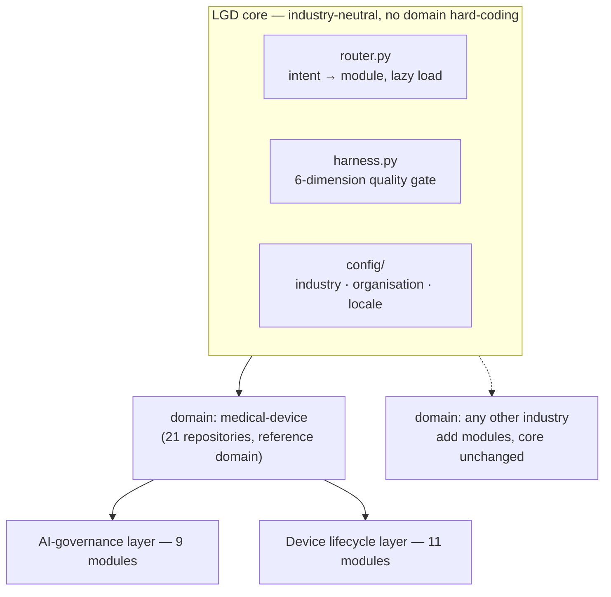
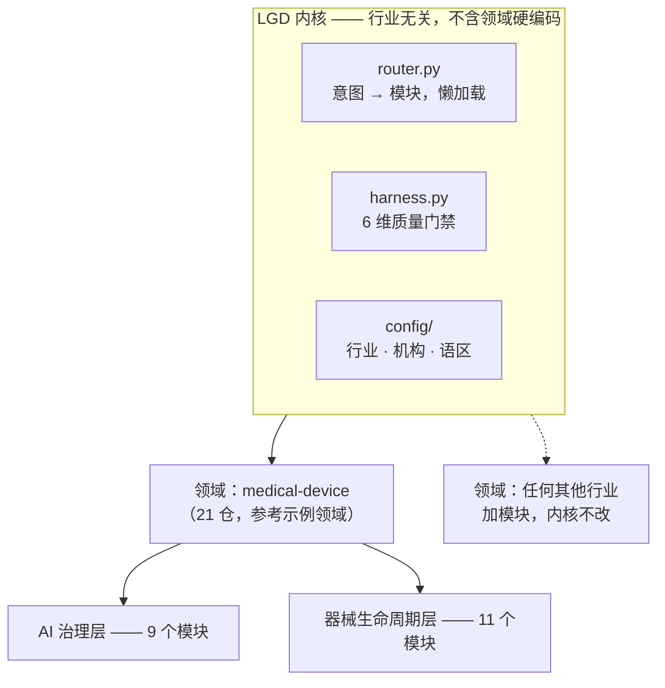

# medical-ai-toolkit

> Entry point for a **21-repository open toolkit for the full lifecycle of medical-device AI**, built on **LGD** — a plugin framework in which every capability is a declarative, independently loadable module. Medical devices are the reference domain; the skeleton itself is industry-neutral.
>
> Contributed by [@stevenzhao07](https://github.com/stevenzhao07) · Affiliation: MedXpert (medical-device RA & regulatory consultancy) · Pure technical input, no commercial promotion.

[](./LICENSE)
[](https://www.python.org/)
[](#quick-start)

**Contents** · [English](#english) · [中文](#中文)

---

## English

### What this is

This repository is the **portal and router** for 21 repositories published under `@stevenzhao07`. It holds no product code of its own; it is the index, the routing table, and the methodology entry point.

The 21 repositories split into three parts:

| Part | Count | What it covers |
|---|---|---|
| AI-governance layer | 9 | Regulatory/quality mapping, AI governance checks, model passports, runtime constraints, interoperability, multilingual labelling, engineering validation |
| Device lifecycle layer | 11 | Design controls through post-market surveillance for medical devices as physical products |
| This portal | 1 | Routing, machine-discoverable manifests, self-test harness |

Every module ships as a **zero-dependency Python CLI** that runs on the standard library alone — no cloud service, no `scikit-learn`, no network access required. That choice is deliberate: compliance artifacts must be auditable offline and reproducible years later.

### LGD: the framework underneath

LGD is a governance framework organised around one idea: **the core stays industry-neutral, and every domain capability is a plugin loaded on demand.**



Four properties define it:

| Property | What it means in practice |
|---|---|
| **Everything is a plugin** | A capability is described by a declarative `module.json` (id, triggers, provides, entry, dependencies). Adding one does not touch the core. |
| **Load on demand** | `router.py` reads metadata only, and loads a module's full text only when its triggers match — roughly 20 tokens per module at rest. |
| **Nestable** | A module may itself act as an entry point that routes to sub-modules. This portal is exactly that: a module made of modules. |
| **Configurable, not forked** | Industry, organisation and locale live in `config/`. Adopters adapt through configuration and their own private plugins instead of patching the core. |

Why it is shaped this way: the same skeleton that sequences a European MDR clinical evaluation also sequences a finance controls review or a legal compliance workflow — the *ordering*, *gating* and *audit trail* are the reusable parts, not the domain content.

### The medical-device reference domain

The medical field is the first and deepest domain implemented on LGD. It is split into two layers.

**Layer 1 — AI-governance (9 repositories)**

| Layer | Repository | Standards / regulations referenced |
|---|---|---|
| Regulatory & quality system | [samd-ra-toolkit](https://github.com/stevenzhao07/samd-ra-toolkit) | NMPA · EU MDR · FDA · PMDA cross-jurisdiction mapping; IEC 62304; ISO 14971 |
| AI governance | [ai-governance-checklist](https://github.com/stevenzhao07/ai-governance-checklist) · [ai-a3-laws](https://github.com/stevenzhao07/ai-a3-laws) · [ai-model-passport](https://github.com/stevenzhao07/ai-model-passport) | Model/data cards; authority–autonomy–accountability constraints; model identity and provenance |
| Data interoperability | [fhir-ortho-toolkit](https://github.com/stevenzhao07/fhir-ortho-toolkit) · [omop-ortho-toolkit](https://github.com/stevenzhao07/omop-ortho-toolkit) | HL7 FHIR R4 (UDI profiles); OHDSI OMOP CDM v5.4 |
| Engineering validation | [ml-validation-toolkit](https://github.com/stevenzhao07/ml-validation-toolkit) · [delivery-guard](https://github.com/stevenzhao07/delivery-guard) | Performance, calibration, fairness; 17 pre-delivery gates and dual SHA-256 provenance |
| Multilingual localisation | [multilingual-ifu](https://github.com/stevenzhao07/multilingual-ifu) | 14 language versions (zh master + 13 foreign) of an IFU template |

**Layer 2 — device lifecycle (11 repositories)**

| Stage | Repository | Main standard / regulation |
|---|---|---|
| Design controls | [design-controls-toolkit](https://github.com/stevenzhao07/design-controls-toolkit) | ISO 13485 §7.3 / 21 CFR 820.30 / IEC 62366-1 |
| Risk management | [iso14971-risk-file](https://github.com/stevenzhao07/iso14971-risk-file) | ISO 14971 / TR 24971 |
| Software lifecycle | [iec62304-software](https://github.com/stevenzhao07/iec62304-software) | IEC 62304 (class A/B/C, SOUP) |
| Classification & route mapping | [device-regulatory-map](https://github.com/stevenzhao07/device-regulatory-map) | NMPA / EU MDR / FDA / PMDA |
| Clinical evaluation | [clinical-evaluation](https://github.com/stevenzhao07/clinical-evaluation) | MDR Art.61 · MDCG · CER + PMCF |
| Biocompatibility | [biocompatibility-iso10993](https://github.com/stevenzhao07/biocompatibility-iso10993) | ISO 10993-1 endpoint matrix |
| Sterilisation & cleaning | [sterilization-validation](https://github.com/stevenzhao07/sterilization-validation) | ISO 11135 / 11137 / 17665; endotoxin limits |
| Production quality | [manufacturing-gmp](https://github.com/stevenzhao07/manufacturing-gmp) | GMP 2025 revision / IQ·OQ·PQ |
| UDI assignment | [udi-assignment](https://github.com/stevenzhao07/udi-assignment) | GS1 / HIBCC / ICCBBA / 21 CFR 830 / EUDAMED |
| Post-market surveillance | [pms-vigilance](https://github.com/stevenzhao07/pms-vigilance) | NMPA Order No.1 & No.29 / MDR Art.87; recall timelines |
| Cybersecurity | [cybersecurity-medical](https://github.com/stevenzhao07/cybersecurity-medical) | IEC 81001-5-1 / SBOM / STRIDE |

The two layers form one unbroken chain: **design controls → risk management → software lifecycle → classification → clinical evaluation → biocompatibility → sterilisation → production → UDI → post-market surveillance → cybersecurity.**

### Why this exists

Most open medical-AI material is either a single link in the chain or English-only. This toolkit was built to close three specific gaps:

| Gap observed | What this toolkit does |
|---|---|
| Lifecycle tools exist in isolation, forcing teams to stitch them by hand | 21 modules share one contract and one routing table, so stages hand off without glue code |
| Regulatory content assumes US/EU only | Chinese regulation (NMPA orders, GMP revision, recall timelines) is covered alongside MDR/FDA/PMDA |
| Readable by humans, invisible to AI agents | Each module ships `AGENTS.md`, `CLAUDE.md`, `llms.txt` and A2A agent cards, so coding agents discover and call modules without being told |

On verifiability: regulations and standards change, so every factual assertion in these modules states its source, and anything that could not be confirmed against a primary text is marked `TO_BE_VERIFIED` rather than filled with a plausible number. If you find a value that is wrong or out of date, that is a reportable bug, not a nitpick.

**What this is not.** It provides structured templates and calculations, not regulatory, clinical, or compliance conclusions. It does not reproduce regulatory texts. It is not a medical device or software-as-a-medical-device product. Decisions on registration, clinical evaluation, sterilisation, risk analysis and software classification must be made by qualified personnel against the current official text of the applicable jurisdiction.

### Quick start

```bash
git clone https://github.com/stevenzhao07/medical-ai-toolkit.git
cd medical-ai-toolkit
python scripts/discover.py --demo                 # print the routing table for all 21 repositories
python harness.py --module medical-ai-toolkit     # run the 6-dimension self-test
```

Requirements: Python 3.8+. No third-party packages. No network access.

To try a single module, for example the sterilisation calculator:

```bash
git clone https://github.com/stevenzhao07/sterilization-validation.git
cd sterilization-validation
python scripts/sterilization_val.py --demo
```

### How to participate

Four ways in, in ascending order of effort:

1. **Report an error.** Regulatory values, standard numbers, clause references and dates are all fair game. Open an [issue](https://github.com/stevenzhao07/medical-ai-toolkit/issues) with the source that contradicts us; corrections are the highest-value contribution here.
2. **Try it and say what broke.** Run a module on your own device or dataset and describe where it stopped being useful.
3. **Contribute a module or a fix.** Read [AI_PARTICIPATION.md](./AI_PARTICIPATION.md) for the branch convention, the AI-attribution trailer, and the reading order. Both human and AI-authored contributions follow the same path.
4. **Own a module.** If you want to maintain one of the 21 repositories — keeping its standards current is continuous work — open an issue saying which one and what you would change. Handing over a module to an outside maintainer is an outcome we want, not a concession.

**Other industries are explicitly welcome.** LGD is not a medical framework that happens to be medical; the core is domain-neutral, and the medical matrix is the worked example. A finance, legal, or industrial-safety practitioner can fork the skeleton, keep `router.py` and `harness.py`, and add their own `domains/` modules without touching anything medical. Proposals in that direction are as welcome as medical contributions.

### Files and licence

| File | Purpose |
|---|---|
| `skeleton.json` | The routing table: all 21 modules with entry points and triggers |
| `AGENTS.md` / `CLAUDE.md` / `llms.txt` / `llms-full.txt` | Machine-discoverable manifests |
| `.well-known/agent-card.json` | A2A 1.0 agent card |
| `harness.py` | 6-dimension quality gate (fit, accuracy, fluency, outsider run, usability, gold regression) |
| `scaffold.py` | Generator for new modules built on the same contract |
| `discover.py` | Prints the routing table; `--json` for machine output |

Licence: **CC BY 4.0** — see [LICENSE](./LICENSE). Individual modules carry CC0, CC BY 4.0 or Apache-2.0 as stated in their own repositories.

---

## 中文

### 这是什么

本仓是 `@stevenzhao07` 名下 **21 个仓库**的**门户与路由总入口**。它本身不含产品代码，只承担三件事：索引、路由表、方法论入口。

21 个仓库分三部分：

| 部分 | 数量 | 覆盖内容 |
|---|---|---|
| AI 治理层 | 9 | 法规与质量体系映射、AI 治理自检、模型护照、运行时约束、数据互操作、多语种标签、工程验证 |
| 器械本体全生命周期层 | 11 | 从设计控制到上市后警戒的器械实体生命周期 |
| 本门户 | 1 | 路由、机器可发现清单、自检测试框架 |

每个模块都是一个**零依赖 Python 命令行工具**，仅用标准库即可运行 —— 不需要云服务、不需要 `scikit-learn`、不需要联网。这是刻意的取舍：合规产物必须能在离线环境审计，并在多年后仍可复现。

### LGD：底下的那套框架

LGD 是一套以「**内核与行业无关、领域能力皆插件、按需加载**」为组织原则的治理框架。



四条性质定义了它：

| 性质 | 具体含义 |
|---|---|
| **一切即插件** | 一个能力由声明式 `module.json` 描述（id、触发词、提供能力、入口、依赖）；新增模块不触碰内核。 |
| **按需加载** | `router.py` 静止时只读元数据，命中触发词才载入模块全文 —— 每个模块常驻开销约 20 token。 |
| **可嵌套** | 模块本身可以再作为入口去路由子模块。本门户正是如此：由模块组成的模块。 |
| **配置化，而非改码** | 行业、机构、语区都放在 `config/`。采用方通过配置与自有私有插件适配，而不是改内核源码。 |

为什么长成这样：同一套骨架，既能编排一次欧盟 MDR 临床评价，也能编排一次财务内控复核或法律合规流程 —— 可复用的是**顺序、门禁与审计轨迹**，不是领域内容本身。

### 医疗领域：参考实现

医疗是 LGD 上第一个、也最深的领域，分两层。

**第一层 —— AI 治理（9 仓）**

| 层 | 仓库 | 引用标准 / 法规 |
|---|---|---|
| 法规与质量体系 | [samd-ra-toolkit](https://github.com/stevenzhao07/samd-ra-toolkit) | NMPA · EU MDR · FDA · PMDA 跨辖区映射；IEC 62304；ISO 14971 |
| AI 治理 | [ai-governance-checklist](https://github.com/stevenzhao07/ai-governance-checklist) · [ai-a3-laws](https://github.com/stevenzhao07/ai-a3-laws) · [ai-model-passport](https://github.com/stevenzhao07/ai-model-passport) | 模型卡/数据卡；权限–自主–追责三约束；模型身份与溯源 |
| 数据互操作 | [fhir-ortho-toolkit](https://github.com/stevenzhao07/fhir-ortho-toolkit) · [omop-ortho-toolkit](https://github.com/stevenzhao07/omop-ortho-toolkit) | HL7 FHIR R4（UDI 轮廓）；OHDSI OMOP CDM v5.4 |
| 工程验证 | [ml-validation-toolkit](https://github.com/stevenzhao07/ml-validation-toolkit) · [delivery-guard](https://github.com/stevenzhao07/delivery-guard) | 性能/校准/公平性；17 道交付门禁 + 双 SHA-256 权属台账 |
| 多语种本地化 | [multilingual-ifu](https://github.com/stevenzhao07/multilingual-ifu) | IFU 模板 14 个语言版本（zh 母版 + 13 外语） |

**第二层 —— 器械生命周期（11 仓）**

| 阶段 | 仓库 | 主线标准 / 法规 |
|---|---|---|
| 设计控制 | [design-controls-toolkit](https://github.com/stevenzhao07/design-controls-toolkit) | ISO 13485 §7.3 / 21 CFR 820.30 / IEC 62366-1 |
| 风险管理 | [iso14971-risk-file](https://github.com/stevenzhao07/iso14971-risk-file) | ISO 14971 / TR 24971 |
| 软件生命周期 | [iec62304-software](https://github.com/stevenzhao07/iec62304-software) | IEC 62304（A/B/C 分级、SOUP） |
| 分类与路径映射 | [device-regulatory-map](https://github.com/stevenzhao07/device-regulatory-map) | NMPA / EU MDR / FDA / PMDA |
| 临床评价 | [clinical-evaluation](https://github.com/stevenzhao07/clinical-evaluation) | MDR Art.61 · MDCG · CER + PMCF |
| 生物相容性 | [biocompatibility-iso10993](https://github.com/stevenzhao07/biocompatibility-iso10993) | ISO 10993-1 终点矩阵 |
| 灭菌与清洁 | [sterilization-validation](https://github.com/stevenzhao07/sterilization-validation) | ISO 11135 / 11137 / 17665；内毒素限值 |
| 生产质量 | [manufacturing-gmp](https://github.com/stevenzhao07/manufacturing-gmp) | GMP 2025 修订版 / IQ·OQ·PQ |
| UDI 赋码 | [udi-assignment](https://github.com/stevenzhao07/udi-assignment) | GS1 / HIBCC / ICCBBA / 21 CFR 830 / EUDAMED |
| 上市后警戒 | [pms-vigilance](https://github.com/stevenzhao07/pms-vigilance) | NMPA 令第 1 号 / 第 29 号 / MDR Art.87；召回时限 |
| 网络安全 | [cybersecurity-medical](https://github.com/stevenzhao07/cybersecurity-medical) | IEC 81001-5-1 / SBOM / STRIDE |

两层连成一条不断链的路径：**设计控制 → 风险管理 → 软件生命周期 → 分类 → 临床评价 → 生物相容性 → 灭菌 → 生产 → UDI → 上市后警戒 → 网络安全。**

### 为什么做这件事

网上开源的医疗 AI 材料，多数要么只是链条中的一环，要么只有英文。这套工具针对三个具体缺口：

| 观察到的缺口 | 本工具的做法 |
|---|---|
| 生命周期工具彼此孤立，团队得手工拼接 | 21 个模块共用一份契约与一张路由表，阶段之间无需胶水代码 |
| 法规内容默认只讲美欧 | 中国的法规（NMPA 令、GMP 修订、召回时限）与 MDR/FDA/PMDA 并列覆盖 |
| 人读得懂、AI 代理看不见 | 每个模块都带 `AGENTS.md`、`CLAUDE.md`、`llms.txt` 与 A2A 代理卡，编码代理无需被告知即可发现并调用 |

关于可核实性：法规与标准一直在变，因此这些模块里的每条事实性断言都标出来源；凡是无法对照一手文本确认的，标注 `TO_BE_VERIFIED`，而不是填一个看起来合理的数字。若你发现某个值有错或过期，那是一个可报的缺陷，不是吹毛求疵。

**这不是什么。** 本工具只提供结构化模板与计算能力，**不构成法规建议、临床建议或合规结论**；不复制法规全文；也不是医疗器械或 SaMD 产品。注册、临床评价、灭菌、风险分析、软件分级等决策，须由合资格人员依据目标辖区（NMPA / FDA / EU MDR / PMDA）最新官方文本作出。

### 快速开始

```bash
git clone https://github.com/stevenzhao07/medical-ai-toolkit.git
cd medical-ai-toolkit
python scripts/discover.py --demo                 # 打印 21 仓路由表
python harness.py --module medical-ai-toolkit     # 跑 6 维自检
```

环境要求：Python 3.8+，无第三方依赖，无需联网。

试单个模块（以灭菌计算器为例）：

```bash
git clone https://github.com/stevenzhao07/sterilization-validation.git
cd sterilization-validation
python scripts/sterilization_val.py --demo
```

### 如何参与

四种方式，门槛由低到高：

1. **挑错。** 法规数值、标准号、条款引用、日期，全都欢迎质疑。请提 [Issue](https://github.com/stevenzhao07/medical-ai-toolkit/issues) 并附上与你所指相矛盾的来源 —— 在这里，纠错是价值最高的贡献。
2. **试用并反馈。** 用你自己的器械或数据跑一个模块，告诉我们它在哪里开始不好用。
3. **贡献模块或修复。** 分支命名、AI 署名 trailer、推荐阅读顺序见 [AI_PARTICIPATION.md](./AI_PARTICIPATION.md)；人类与 AI 作者的贡献走同一条路径。
4. **认领一个模块。** 若你愿意长期维护 21 仓中的某一个（让它的标准保持更新是持续工作），提 Issue 说明你想接手哪个、打算改什么。把模块交给外部维护者，是我们想要的结果，不是让步。

**其他行业同样欢迎，且是明确欢迎。** LGD 不是"碰巧偏医疗"的医疗框架 —— 内核与行业无关，医疗矩阵只是那个已经做出来的样例。金融、法律、工业安全的从业者可以 fork 骨架、保留 `router.py` 与 `harness.py`，直接加自己的 `domains/` 模块，完全不碰医疗部分。这个方向的提案与医疗贡献一视同仁。

### 文件与许可

| 文件 | 用途 |
|---|---|
| `skeleton.json` | 路由表：21 个模块的入口与触发条件 |
| `AGENTS.md` / `CLAUDE.md` / `llms.txt` / `llms-full.txt` | 机器可发现清单 |
| `.well-known/agent-card.json` | A2A 1.0 代理卡 |
| `harness.py` | 6 维质量门禁（适配/准确/流畅/外人实跑/易用/gold 语义回归） |
| `scaffold.py` | 按同一契约生成新模块 |
| `discover.py` | 打印路由表；`--json` 输出机器可读格式 |

许可：**CC BY 4.0** —— 见 [LICENSE](./LICENSE)。各子模块许可在其仓库内声明（CC0 / CC BY 4.0 / Apache-2.0 混合）。
